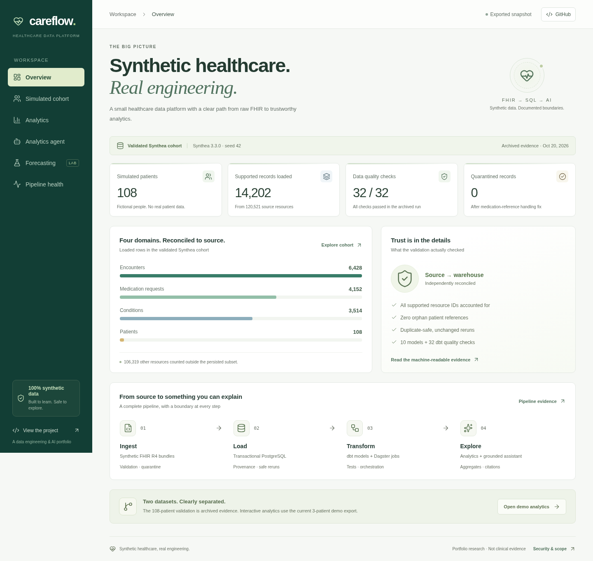

# Careflow — synthetic healthcare, real engineering

[Website security audit](docs/security-audit.md): findings, fixes, validation and hosting limits.

A lightweight, responsive portfolio website for the
[Careflow data platform](https://github.com/elitay152/Careflow). React,
TypeScript and Vite render a reviewed aggregate JSON export. There is no
database connection, API key, model request or ingestion logic in this repo.



## Run independently

Requires Node 24 LTS and npm. No backend, Docker, credentials or Codex settings
are required for the committed snapshot.

```bash
npm ci
npm run dev
# Production build, including data contract and TypeScript checks:
npm run build
npm run preview
```

The generated `dist/` directory can be served by a static host. Relative asset
paths and hash navigation support a repository subpath without server rewrites.
See [GitHub Pages deployment](docs/deployment.md) for the one-time settings and
reviewed workflow. Once enabled, successful checks on `main` publish only the
validated static build; pull requests never deploy.

## What the six pages show

| Page | Scope |
| --- | --- |
| Overview | Archived, documented Synthea results: 108 patients, 14,202 supported records, 32 passed checks and zero quarantines. |
| Simulated cohort | Searchable aggregate inventory of source FHIR resource types, with the persisted subset clearly marked. No patient-level records. |
| Analytics | The current three-patient hand-authored demo export. Metric switching, exact monthly values, condition prevalence and medication statuses. |
| Analytics agent | Replay of three baseline responses exported by Careflow, with source definitions and caveats. Free-form inputs outside those examples are declined; there is no live API connection. |
| Forecasting | Explicitly unevaluated research plan. No invented predictions, intervals or accuracy metrics. |
| Pipeline health | Actual source-load, dbt invocation and snapshot timestamps; the demo's intentional quarantine remains visible. No uptime or active-schedule claims. |

The archived Synthea cohort and current demo are separate datasets. The larger
source dataset is not committed here. Reloading a page does not rerun a pipeline
or update any evidence timestamp. All data is synthetic, not clinical evidence.

## Refresh from Careflow

Careflow's merged `export-public` command produces this contract. See the
backend's [export documentation](https://github.com/elitay152/Careflow/blob/main/docs/public-dashboard.md).

In the backend checkout, after a successful synthetic demo pipeline:

```bash
set -a
. ./.env
set +a
.venv/bin/careflow export-public --confirm-synthetic \
  --dbt-artifacts warehouse/target \
  --archive docs/validation-results.json --archive-date 2026-10-20 \
  --output data/public/careflow.json
```

Then in this repo:

```bash
# Defaults to ../Careflow/data/public/careflow.json:
npm run data:sync
# Or supply an explicit existing aggregate export:
npm run data:sync -- /path/to/Careflow/data/public/careflow.json
npm run build
```

Review the aggregate JSON before committing it. The copy script checks the
version and expected contract; it does not de-identify a dataset or prove it is
synthetic. Never copy `.env`, raw FHIR bundles, database credentials, API keys,
usage ledgers or patient-level exports. Keep any future live agent credentials
and request controls on a backend.

Version 1 includes current aggregates and dbt evidence, a separate archived
validation summary, baseline example responses, and explicit null forecast
results. Dates are displayed in UTC. Missing months are not synthesized as zero;
condition groups can overlap; medication requests do not imply dispensing.

## Validation

```bash
npm audit
npm run test:security
npm run build
npx playwright install chromium
npm test
npm run test:pages
```

For an existing Chromium installation:

```bash
PLAYWRIGHT_CHROMIUM_EXECUTABLE_PATH=/usr/bin/chromium npm test
```

The 26 desktop/mobile browser tests cover all pages, keyboard-accessible tables,
navigation/history, resource filtering, baseline replay and unsupported inputs,
exact current values, dataset separation, evidence download, and honest forecast
empty states. Each page is checked with axe's WCAG A/AA rules and for horizontal
overflow, JavaScript errors and unexpected outbound requests. These automated
checks do not replace a complete accessibility audit.

Additional browser cases verify CSP enforcement and inert hostile agent input.
`npm run test:security` exercises strict snapshot validation, atomic sync and the
public/build artifact allowlists. Builds reject unexpected files, symlinks and
source maps before a release can be accepted.

CI uses `npm ci`, advisory checks, 27 Node security tests, tracked-file secret
checks, the production build and Playwright at both root and repository paths.
Actions are pinned to commit SHAs. The check job has read-only repository
contents access; only the separate deployment job gets Pages publishing and
OIDC permissions. It publishes checked builds from `main` when Pages is enabled
and runs no paid evaluations. Hosted CI/deployment results must be checked on
GitHub; local tests alone do not establish a hosted pass or a live website.
