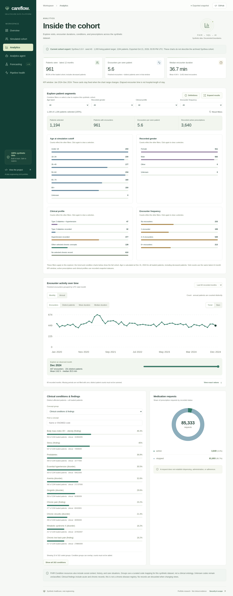

# Careflow dashboard

A React/TypeScript portfolio website for the
[Careflow healthcare data platform](https://github.com/elitay152/Careflow).
It renders aggregate synthetic data exported from PostgreSQL. The public browser
has no database connection, model credentials, or live agent endpoint.

**Website:** https://elitay152.github.io/careflow-dashboard/



## Run

Requires Node 24 and npm. The committed snapshot runs without a backend:

```bash
npm ci
npm run dev
```

`npm run build` validates the snapshot, checks release files, and builds `dist/`.
`npm run preview` serves that build locally. Hash navigation and relative assets
support the GitHub Pages repository path.

## Pages

| Page | Contents |
| --- | --- |
| Overview | Current cohort counts and dbt evidence. |
| Simulated cohort | Aggregate inventory of six persisted FHIR resource types, including selected clinical Observations and provider organizations. |
| Analytics | Latest-12-month KPIs, monthly/annual trends, duration statistics, clinical/contextual groups, and medication request statuses. |
| Analytics agent | Three cited baseline answers replayed from the export; other inputs are declined. |
| Forecasting | Facility/ZIP demand histories, guided ambulatory examples, an editable appointment-capacity scenario, and model development benchmarks. |
| Inpatient risk study | Adult 90-day mixed-setting inpatient-episode experiment with readiness, patient/time splits, baselines, and aggregate calibration. |
| Pipeline health | Source-load, build, and export timestamps, quality checks, quarantines, and downloadable evidence. |

The snapshot contains 1,194 synthetic patients and a reference catalog of 852
provider organizations. Provider names are reference data; patient histories and
facility assignments are simulated. Metrics describe recorded
simulation data, not real healthcare demand or historical population rates.
[Definitions and forecast protocol](https://github.com/elitay152/Careflow/blob/main/docs/metrics.md)
live in Careflow, alongside the calculations.

The appointment scenario replays the latest 12 calendar months with observations.
Sessions, hours, appointment length, bookable time, and demand change are editable
assumptions. Whole slots are rounded down per clinician session; scenario visits
are rounded up, and monthly shortfalls do not carry forward. It runs locally over
exported counts without forecasting future demand or estimating real staffing.
The steady/increasing/decreasing examples use recorded histories, not model scores.
`npm test` checks the arithmetic before running the browser suite.

## Refresh from PostgreSQL

With both repos side by side and the backend's local PostgreSQL running:

```bash
npm run data:refresh -- --confirm-synthetic
```

This rebuilds/tests dbt, exports aggregates, validates and atomically copies the
snapshot, and builds the site. Defaults: `../Careflow`, raw schema
`synthea_p1000_seed43`, analytics schema `synthea_p1000_seed43_analytics`, seed-43
label. For a different cohort:

```bash
npm run data:refresh -- --confirm-synthetic \
  --backend-root /path/to/Careflow \
  --raw-schema my_cohort --analytics-schema my_cohort_analytics \
  --label "My synthetic cohort"
```

Credentials stay in the backend's `.env` or environment. Stop other loaders/dbt
jobs during refresh. The command reads existing data; it does not ingest,
schedule, or publish. Review the snapshot change and merge it to `main` for Pages
deployment. A browser reload alone does not refresh PostgreSQL data.

For an existing export, use `npm run data:sync -- /path/to/careflow.json`, then
`npm run build`. The site requires contract version 8. Analytics includes an aggregate cohort explorer with combined demographic, clinical-profile, and encounter-frequency filters; these filters apply only to the explorer. Only reviewed aggregate
JSON belongs in `public/data/`; keep raw files, ledgers, keys, and dumps outside it.

## Small reproducible demo

Start in the backend checkout:

```bash
bash scripts/bootstrap.sh
cd ../careflow-dashboard
npm ci
npm run data:refresh -- --confirm-synthetic \
  --raw-schema public --analytics-schema analytics \
  --label "Hand-authored extended demo"
npm run dev
```

This demonstrates ingestion, quarantine, dbt checks, and refresh with three
fictional patients. Its short history produces an explicit unevaluated forecast.
The command replaces the local snapshot; rerun the default refresh to select the
retained larger cohort. For generation from scratch, use Careflow's
[cohort validation guide](https://github.com/elitay152/Careflow/blob/main/docs/validation.md).
Neither demo path needs a paid model or AWS service.

## Checks and hosting

```bash
npm ci
npm audit
npm run test:security
npm run build
npx playwright install chromium
npm test
npm run test:pages
```

Set `PLAYWRIGHT_CHROMIUM_EXECUTABLE_PATH=/usr/bin/chromium` to use an installed
browser. Tests cover desktop/mobile pages, keyboard controls, accessibility,
evidence integrity, CSP, and the real Pages subpath. Run logs and traces stay local.

- [GitHub Pages deployment](docs/deployment.md)
- [Security boundaries](docs/security-audit.md)
